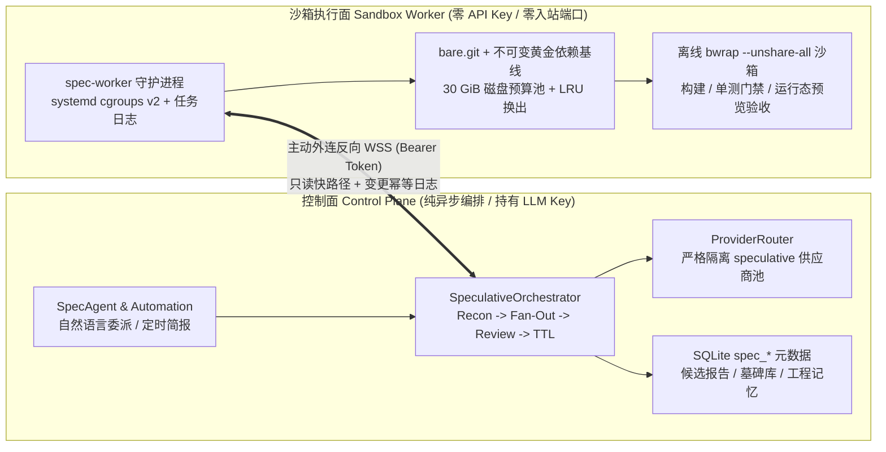

# Speculative Coding

注：这是一个玩具级的小东西，仅展示设计理念，不推荐任何人拿来使用

> **用富余算力换代码质量与架构探索的 24 小时自主投机编码引擎**
>
> *An autonomous, dual-node speculative coding engine built around surplus-token exploration, zero-trust sandbox isolation, ref-only dehydration, strict LLM pool isolation, and human-only merge authority.*

[](https://www.python.org/downloads/)
[](#系统架构)
[](#核心设计理念)

---

## 核心设计理念 (Design Philosophy)

传统的 Coding Agent 是**指令驱动**（Command-Driven）的：人类提出明确需求，Agent 在单工作区线性推进，目标是 100% 确定性交付。

**Speculative Coding**（投机编码）针对的是另一类被长期忽视的工程场景——**用富余或廉价/免费的 Token 算力，在无人值守的后台持续为代码库“淘金”**，探索架构优化、隐蔽缺陷修复与下一代功能原型。为了让这套范式真正可用、可控且不制造垃圾 PR，整个系统围绕六条核心第一性原理设计：

### 1. 探索与交付分离：多路线扇出、赛马试错、宁缺毋滥
- **先全景调研，再扇出 $0 \sim N$ 条路线**：Recon 阶段通读代码树、近期提交、工程记忆以及**墓碑负样本库（Graveyard）**（严禁重复提出已被淘汰或无价值的方向），产出正交优化路线或同题赛马路线（`competition_group`）。
- **静默哲学（Zero-Noise Silence）**：如果当前代码库没有高价值切入点，或者本轮候选路线全部未达到优秀标准，系统**什么也不生成、保持绝对安静**——不发垃圾通知，不堆积低质量分支。

### 2. 绝对权力红线：模型只有淘汰与提名权，人类独占合并权
- 模型在全链路中仅有 **`DROP`（直接淘汰）**、**`REVISE`（给出具体意见打回重改）** 与 **`NOMINATE`（达标提名并生成报告预览）** 三种裁决权；同题赛马路线（`competition_group`）在达标后还会经过独立的 **Tournament Judge（锦标赛终审）** 自动优胜劣汰。
- **物理剥夺危险能力**：模型侧永远拿不到 `merge`、`push`、`deploy`、凭据访问或 TTL 控制工具；候选代码禁止触碰受保护路径（`.git`、`.env*`、`.ssh`、`deploy`、`.github` 等），且默认**禁止修改或删除已有测试文件**（仅在项目显式开启 `allow_test_edits` 时放行，并强制运行基线测试回归校验且在审阅界面高亮标出）。
- 人类通过控制面或内置 **Review Web UI** 执行的 `keep / steer / drop / export / merge` 全部幂等且绑定所有者；支持导出 `.patch` 与便携式 `.bundle`；合并操作采用 **SHA-pinned CAS 本地合并**，永不自动向远端 `git push`。

### 3. 零信任双节点物理分离（Control Plane + Sandbox Worker）
- **控制面（Control Plane）**：只运行纯异步 LLM 推理编排、状态机与 SQLite 元数据（内存占用极低），集中保管全部 LLM API Key 与可选 GitHub App 凭据；**零本地编译、零重型依赖安装**，绝不因构建任务拖垮主业务或触发 OOM。
- **专职沙箱执行面（Sandbox Worker）**：只负责裸仓库（`bare.git`）、多 Worktree 派生、离线门禁构建与运行态验收。**零 API Key 落盘、零公网入站端口暴露**——由 Worker 携带 `SPEC_WORKER_TOKEN` 主动发起反向 WSS 外连，所有构建与测试命令均运行在无网 `bwrap --unshare-all` 与 `systemd` cgroups v2 内存围栏内。

### 4. 防爆盘防 OOM 组合拳：三级并发 + 不可变黄金依赖基线
面对动辄数 GB 依赖与资产的现代项目，多开 Worktree 最容易瞬间打爆磁盘与内存。系统通过四层机制根治该问题：
1. **三级解耦并发**：L1 脑力推理槽（控制面，高并发） / L2 增量工作区槽（执行面，仅 MB 级增量） / L3 重型构建验收槽（执行面，严格限流并在高水位自动降为串行）。
2. **不可变只读黄金基线（Immutable Golden Baselines）**：按 lockfile 哈希在 `golden_bases/` 预构建一次 `node_modules` / `.venv`，通过 `bwrap --ro-bind` 只读挂载进每个并行沙箱——多条候选路线共享同一份底层依赖，既不重复占盘，也防止单条路线污染共享环境。
3. **三级磁盘水位与 LRU 换出**：`< 75%` 正常常驻，`75%–100%` 按 LRU 淘汰未租借项目的热基线并串行化构建，`>= 100%` 或宿主机剩余低于保底阈值时暂停准入并由看门狗终止失控子进程。
4. **崩溃与断连可恢复**：只读查询走无落盘快路径；变更类任务在控制面与 Worker 双端落盘确定性任务日志（Task Journal），网络抖动或重启后幂等续传。

### 5. 默认脱水留存（Ref-only Dehydration）与 TTL 自动垃圾回收
- 候选路线通过严审晋级后，Worker 立即将结果提交到裸仓的轻量 Git 引用 `refs/spec/<cand_id>`，仅回传精炼的人话报告、增量 `diff` 与受限预览包（前端预览强制加装 `CSP: sandbox allow-scripts; connect-src 'none'`），**当场 `rm -rf` 销毁实体 Worktree 目录**。
- 每个待阅候选在裸仓中仅占几十 KB；未人工标记 `Keep` 的候选随 TTL 到期自动删除 ref、写入清理记录并执行 `git gc --prune=now` 物理回收磁盘。

### 6. 供应商池双向硬隔离（Strict Provider Pool Isolation）
- `ProviderRouter` 原生兼容 OpenAI 与 Gemini 协议，支持多 Key 轮询与指数退避冷却，并在架构层将 **`speculative`（投机池）** 与 **`main`（主力池）** 双向硬隔离。
- 投机引擎**只允许使用 `speculative` 池**；池内全部端点进入冷却时自动挂起休眠，**物理零可能穿透消耗主力付费渠道配额**。

---

## 系统架构与工作闭环



### 端到端流水线

```text
1. 深度调研 (Recon)       ──► 扫描仓库树、近期提交、工程记忆与墓碑负样本库，生成 0..N 条高价值路线
2. 扇出派生 (Fan-Out)     ──► 派发至 Sandbox Worker，挂载只读黄金依赖基线并行拉起隔离 Worktree
3. 编码与门禁 (Code/Gate) ──► Coder 并行只读检索 + 精准局部编辑，在无网 bwrap 内跑通确定性构建/测试门禁
4. 独立严审 (Review Loop) ──► 独立 Reviewer（及功能/交互完成度 Inspector）裁决：DROP / REVISE / NOMINATE
                              （连续两轮 diff 停滞或达上限自动 DROP 并记入墓碑库）
5. 脱水存盘 (Dehydrate)   ──► 写入 refs/spec/<cand_id>，回传人话报告与轻量预览，当场销毁实体 Worktree
6. 过期清理与人工裁决      ──► 默认 TTL 到期自动回收；人工可 Keep / Steer（复水微调）/ Drop / Export / CAS Merge
```

更多底层协议、磁盘水位状态机与安全约束详见 [docs/design/architecture.md](docs/design/architecture.md) 与 [deploy/spec-worker/README.md](deploy/spec-worker/README.md)。

---

## 目录结构

```text
speculative_coding/
├── config.py          # SpecConfig、ProviderEndpoint 与供应商池硬隔离
├── protocols.py       # 可插拔 AuthProvider / NotificationSink 协议与适配器
├── llm/               # OpenAI 兼容与原生 Gemini 传输层、ProviderRouter、上下文压缩
├── agent_loop/        # 通用工具循环（并行只读批处理、上下文溢出恢复、输出截断）
├── tool_result.py     # 结构化工具返回与输出边界控制
├── store.py           # 持久化 SQLite 元数据存储（spec_* 表、墓碑库、任务日志）
├── sessions.py        # 轻量 SessionStore、EventBus 与 TurnRunner
├── sandbox.py         # SpecSandboxBackend、RemoteWorkerSandbox、LocalDirSandbox (bwrap)
├── worker.py          # 反向 WSS 沙箱守护进程与崩溃安全任务日志
├── github.py          # GitHub App 短时单仓 Token 客户端与 SpecRepoRegistry
├── provision.py       # 保守门禁推断与基线自动校验（SpecProvisioner）
├── orchestrator.py    # SpeculativeOrchestrator 生命周期、审阅循环、TTL 与 HTTP API
├── agent.py           # SpecAgent 自然语言委派层（仓库解析、工程记忆、证据解释）
├── automation.py      # 持久化定时批跑与晨间审阅简报调度
├── server.py          # 独立 aiohttp 控制面 HTTP / WebSocket 服务与静态 Review UI 托管
├── ui_static/         # 零构建依赖的独立 Review Web UI（项目、审阅队列、Diff/报告/预览、SpecAgent 抽屉）
└── cli.py             # 统一命令行入口（spec-coding / spec-server / spec-worker）
```

---

## 快速起步

### 环境要求
- Python 3.11+、`git`
- 生产沙箱节点推荐使用 Linux + `bubblewrap`（`bwrap`）+ `systemd`

### 1. 安装

```bash
pip install -e ".[dev]"
```

### 2. 配置

复制 [`config.example.json`](config.example.json) 并通过环境变量注入密钥与鉴权令牌：

```bash
export SPEC_OPENAI_API_KEY="sk-..."
export SPEC_API_TOKEN="your-control-plane-bearer-token"
export SPEC_WORKER_TOKEN="$(python -c 'import secrets; print(secrets.token_hex(32))')"
```

也可零配置文件起步，`SpecConfig.from_env()` 自动读取 `SPEC_OPENAI_API_KEY`、`SPEC_OPENAI_BASE_URL`、`SPEC_MODEL`、`SPEC_DATA_DIR`、`SPEC_WORKER_TOKEN` 与 `SPEC_API_TOKEN`。

### 3. 启动控制面服务与 Review Web UI

```bash
spec-coding serve --config config.example.json --host 127.0.0.1 --port 8765
# 或：
spec-server --config config.example.json --host 127.0.0.1 --port 8765
```

启动后浏览器直接访问 `http://127.0.0.1:8765/`（或 `/ui`）即可打开内置的 **Speculative Coding Review Console**（零 Node.js 运行时依赖、完全离线可用、支持浅色/深色主题与 `Bearer` 令牌登录）：
- 实时查看 Worker 在线状态、磁盘水位仪（`normal` / `high` / `blocked`）、活跃 Worktree 数与累计 Token 消耗；
- 管理项目（创建、启停持续模式、一键触发 `Run Batch`、浏览 `Graveyard` 墓碑库）；
- 3 分钟候选审阅工作流：安全 Markdown 人话报告、彩色 Unified Diff + 文件跳转、门禁与基线测试回归证据时间线、沙箱化预览产物，以及人工专属 `Keep / Steer / Drop / Export (.patch + .bundle) / CAS Merge` 操作；
- 右侧内置 **SpecAgent** 委派对话抽屉（基于短时 `ws-ticket` WebSocket，并支持自动降级到 HTTP）。

> **安全说明**：绑定非回环地址（如 `0.0.0.0`）时必须配置 `SPEC_API_TOKEN`（fail-closed）；仅在本地调试且确知风险时可通过 `--insecure-no-auth` 显式放行。

核心 HTTP & WebSocket 接口：
- `GET /` & `GET /ui`（内置独立 Review Web UI）
- `GET /health`
- `GET /api/spec-worker/ws`（Worker 反向 WSS 接入端点，校验 `Bearer $SPEC_WORKER_TOKEN`）
- `GET /api/spec/status`
- `GET / POST /api/spec/projects` & `PATCH /api/spec/projects/{project_id}`
- `POST /api/spec/projects/{project_id}/run` & `GET /api/spec/projects/{project_id}/graveyard`
- `GET /api/spec/candidates` & `GET /api/spec/candidates/{cand_id}` & `GET /api/spec/candidates/{cand_id}/events`
- `GET /api/spec/candidates/{cand_id}/preview/{path}`（严格沙箱 CSP 预览）
- `POST /api/spec/candidates/{cand_id}/{keep|steer|drop|export|merge}`
- `POST /api/spec/agent/turn`、`POST /api/spec/agent/ws-ticket` & `GET /api/spec/agent/ws`（对话式委派 Agent）

### 4. 启动独立沙箱 Worker

在专用 Linux 执行节点运行（生产加固配置见 [deploy/spec-worker/README.md](deploy/spec-worker/README.md)）：

```bash
export SPEC_WORKER_TOKEN="same-32+-char-secret"
spec-coding worker --root /opt/spec_sandbox --server wss://control-plane.example.com/api/spec-worker/ws
# 或：
spec-worker --root /opt/spec_sandbox --server wss://control-plane.example.com/api/spec-worker/ws
```

### 5. 本地 CLI 检查与开发试跑

```bash
# 查看项目、候选与 Token 消耗统计
spec-coding status --data-dir ./data
spec-coding candidates --data-dir ./data
spec-coding export <cand_id> --data-dir ./data
spec-coding export <cand_id> --data-dir ./data --bundle ./candidate.bundle

# 开发/测试环境下运行本地单轮投机批次（需显式开启 --allow-local-sandbox）
spec-coding run --repo /path/to/repo --branch main --gate "python -m pytest" --allow-local-sandbox
```

---

## 测试

```bash
python -X utf8 -m pytest
```

包含编排器、沙箱契约、Worker 幂等日志、供应商池硬隔离、GitHub 仓库注册、自动化简报、Agent 端到端流程，以及零外部历史耦合的 AST 架构守卫测试。

---

## License

MIT
